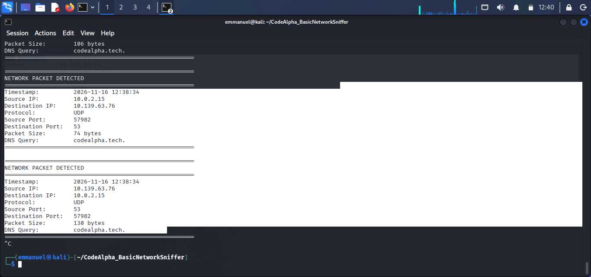
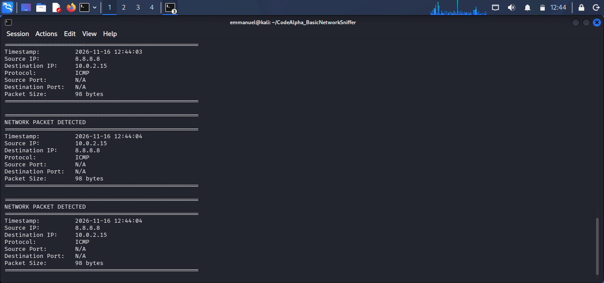
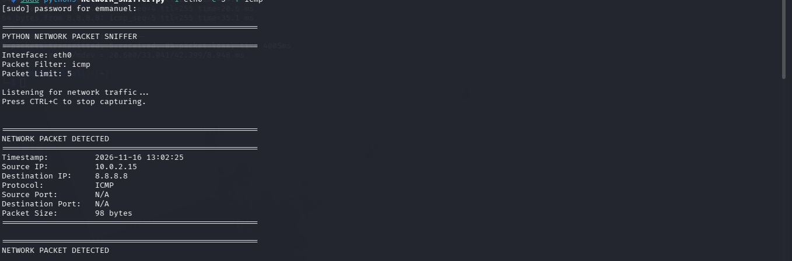

# Python Network Packet Sniffer

A Python-based network packet sniffer developed using **Scapy** to capture, inspect, and analyse network traffic in real time.

This project was developed as part of my **CodeAlpha Cybersecurity Internship** to gain practical experience in network traffic analysis, packet inspection, and network security monitoring.

---

## Project Overview

Network packet analysis is an important aspect of cybersecurity. It helps security professionals understand network communication, identify protocols, inspect traffic patterns, and monitor activity across a network.

This project implements a basic network packet sniffer using Python and Scapy. It captures packets from a specified network interface and extracts relevant information for analysis.

The tool was developed and tested in a Kali Linux environment.

## Project Objectives

- Understand how network packets travel across a network.
- Capture live network traffic using Python.
- Identify common network protocols.
- Extract source and destination IP addresses.
- Inspect TCP and UDP port information.
- Identify DNS queries and requested domain names.
- Apply Berkeley Packet Filter (BPF) expressions.
- Practise network monitoring and packet analysis.

## Technologies and Tools

| Technology | Purpose |
|---|---|
| Python 3 | Programming language |
| Scapy | Packet capture and analysis |
| Kali Linux | Testing environment |
| TCP/IP | Network communication |
| BPF | Packet filtering |
| Git and GitHub | Version control and documentation |

## Features

The packet sniffer supports the following functionality:

1. **Live Packet Capture:** Captures network packets in real time.
2. **IP Address Identification:** Displays source and destination IP addresses.
3. **Protocol Detection:** Identifies TCP, UDP, and ICMP packets.
4. **Port Inspection:** Displays source and destination ports for TCP and UDP traffic.
5. **DNS Query Detection:** Extracts requested domain names from DNS packets.
6. **Packet Size Analysis:** Displays the size of captured packets.
7. **Timestamp Recording:** Displays the time each packet is processed.
8. **BPF Filtering:** Filters traffic based on specified conditions.
9. **Packet Count Limitation:** Allows users to specify how many packets to capture.

```

## Installation and Setup

### 1. Clone the Repository

```bash
git clone https://github.com/emmanuel101cyber/CodeAlpha_BasicNetworkSniffer.git
```

### 2. Navigate to the Project Directory

```bash
cd CodeAlpha_BasicNetworkSniffer
```

### 3. Install Dependencies

```bash
pip install -r requirements.txt
```

If your Kali Linux environment restricts system-wide pip installations, use a Python virtual environment or Kali's packaged Scapy installation.

### 4. Identify Your Network Interface

```bash
ip -br addr
```

Example:

```text
eth0    UP    10.0.2.15/24
```

In this example, `eth0` is the interface used for packet capture.

## Usage

The script requires a network interface.

### Basic Packet Capture

```bash
sudo python3 network_sniffer.py -i eth0
```

### Capture a Specific Number of Packets

```bash
sudo python3 network_sniffer.py -i eth0 -c 10
```

### Capture TCP Traffic Only

```bash
sudo python3 network_sniffer.py -i eth0 -f tcp
```

### Capture UDP Traffic Only

```bash
sudo python3 network_sniffer.py -i eth0 -f udp
```

### Capture ICMP Traffic Only

```bash
sudo python3 network_sniffer.py -i eth0 -f icmp
```

### Capture DNS Traffic Only

```bash
sudo python3 network_sniffer.py -i eth0 -f "udp port 53"
```

### View Available Options

```bash
python3 network_sniffer.py --help
```

Press `CTRL+C` to stop an unlimited packet capture.

## Practical Testing and Results

The project was tested in Kali Linux using the `eth0` network interface.

The following tests were performed to verify the functionality of the packet sniffer.

| Test | Testing Method | Result |
|---|---|---|
| Live packet capture | Captured network traffic on `eth0` | Passed |
| UDP detection | Captured UDP traffic on port 123 | Passed |
| TCP detection | Generated HTTPS traffic using curl | Passed |
| ICMP detection | Pinged `8.8.8.8` | Passed |
| DNS query detection | Queried `codealpha.tech` using nslookup | Passed |
| IP identification | Inspected source and destination addresses | Passed |
| Port inspection | Inspected TCP and UDP ports | Passed |
| Packet size inspection | Examined captured packet lengths | Passed |
| BPF filtering | Captured ICMP traffic using an ICMP filter | Passed |
| Packet count limitation | Restricted capture to five packets | Passed |

### Test 1: UDP Packet Detection

UDP packets were captured during network communication.

The sniffer identified traffic involving destination port `123`, commonly associated with Network Time Protocol (NTP).

### Test 2: ICMP Packet Detection

ICMP traffic was generated using:

```bash
ping -c 5 8.8.8.8
```

The sniffer successfully captured outgoing ICMP Echo Requests and incoming Echo Replies.

### Test 3: TCP Packet Detection

HTTPS traffic was generated using:

```bash
curl -I https://www.codealpha.tech/
```

The sniffer successfully identified TCP traffic associated with destination port `443`.

### Test 4: DNS Query Detection

DNS resolution was tested using:

```bash
nslookup codealpha.tech
```

The DNS lookup successfully returned IPv4 and IPv6 addresses.

The packet sniffer was used to inspect DNS traffic and identify the requested domain.

### Test 5: BPF Filtering

The following command was used:

```bash
sudo python3 network_sniffer.py -i eth0 -c 10 -f icmp
```

The sniffer successfully captured ICMP traffic without displaying unrelated TCP or UDP packets.

### Test 6: Packet Count Limitation

The following command was used:

```bash
sudo python3 network_sniffer.py -i eth0 -c 5 -f icmp
```

The packet sniffer successfully stopped after capturing five packets.

---

## Evidence and Screenshots

Screenshots of the practical implementation and testing process are available in the `screenshots/` directory.

These screenshots provide evidence of the tool's functionality and the tests performed.

### 1. Live Packet Capture

**File:** `02-packet-capture.png`

Evidence of live network traffic capture, including packet information and protocol identification.


### 2. ICMP Packet Detection

**File:** `03-icmp-packet-detection.png`

Evidence showing outgoing and incoming ICMP packets between the Kali machine and `8.8.8.8`.


### 3. TCP Packet Detection

**File:** `04-tcp-packet-detection.png`

Evidence showing TCP traffic captured during an HTTPS connection.


### 4. DNS Query Detection

**File:** `05-dns-packet-detection.png`

Evidence showing DNS traffic inspection and domain query identification.



### 5. BPF Filtering

**File:** `06-bpf-filtering.png`

Evidence showing the packet sniffer capturing ICMP traffic using a BPF filter.



### 6. Packet Count Limitation

**File:** `07-packet-count-test.png`

Evidence showing the packet sniffer successfully limiting packet capture to five packets.



---

## How to Capture and Upload Evidence Screenshots

All screenshots should be captured from the Kali Linux terminal during actual project execution.

### Step 1: Run the Relevant Test

For example:

```bash
sudo python3 network_sniffer.py -i eth0 -c 10 -f icmp
```

### Step 2: Generate Network Traffic

Open another terminal and generate the appropriate traffic.

For ICMP:

```bash
ping -c 5 8.8.8.8
```

### Step 3: Capture the Terminal

Use the Kali Linux screenshot utility or press `PrtSc` on your keyboard.

Ensure the screenshot clearly shows:

- The packet sniffer heading.
- The selected network interface.
- The packet information.
- The detected protocol.
- Relevant source and destination addresses.

Avoid screenshots containing passwords, private information, or unrelated terminal activity.

### Step 4: Save the Screenshot

Use the filenames specified in the Evidence and Screenshots section.

### Step 5: Upload to GitHub

1. Open the project repository.
2. Navigate to the `screenshots` folder.
3. Click **Add file**.
4. Select **Upload files**.
5. Select the screenshot from your computer.
6. Click **Commit changes**.

Repeat these steps for each screenshot.

**Important:** Keep the filenames exactly as specified in this README so the images display correctly on GitHub.

---

## Ethical Considerations

This project was developed for educational and cybersecurity training purposes.

Packet capture should only be performed on networks and systems that you own or have explicit permission to monitor.

The project focuses on packet metadata and protocol identification. It does not decrypt HTTPS communications or bypass network security controls.

## Skills Demonstrated

Through this project, I gained practical experience in:

- Python programming for cybersecurity.
- Network packet capture and inspection.
- TCP/IP protocol analysis.
- TCP, UDP, and ICMP identification.
- DNS traffic analysis.
- BPF packet filtering.
- Kali Linux command-line operations.
- Practical network troubleshooting.
- Technical documentation and GitHub project management.

## Project Status

**Status: Core implementation and functional testing completed.**

The packet sniffer successfully captures and analyses TCP, UDP, ICMP, and DNS traffic, applies packet filters, and supports packet count limitations.

## Author

**Idowu Oluwaferanmi Emmanuel**

Cybersecurity Student | Network Security | Ethical Hacking

GitHub: [@emmanuel101cyber](https://github.com/emmanuel101cyber)

Project Repository: [CodeAlpha_BasicNetworkSniffer](https://github.com/emmanuel101cyber/CodeAlpha_BasicNetworkSniffer)

---

*Developed as part of the CodeAlpha Cybersecurity Internship.*
