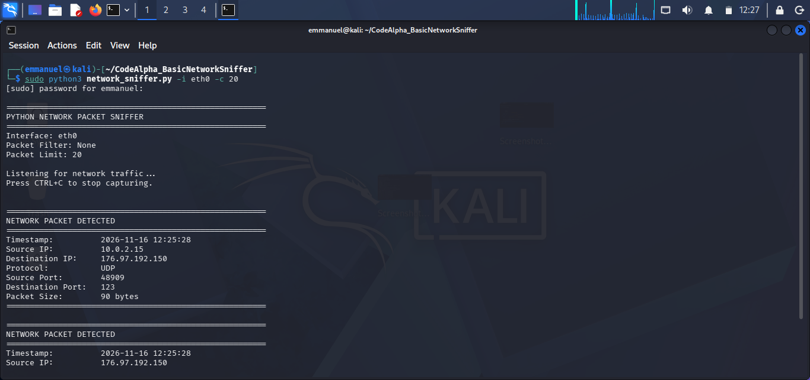
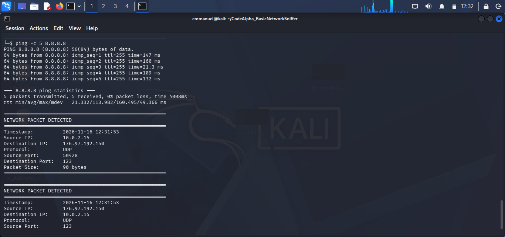
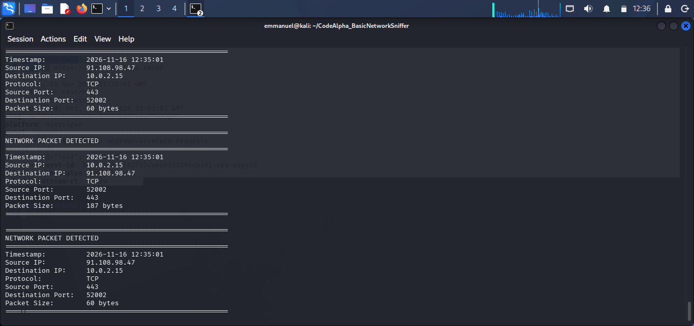

# PYTHON NETWORK PACKET SNIFFER
### Network Traffic Capture, Inspection and Protocol Analysis Using Python and Scapy


---

## 1. PROJECT INFORMATION

| Category | Details |
|---|---|
| Project Title | Python Network Packet Sniffer |
| Project Category | Network Security and Traffic Analysis |
| Internship Programme | CodeAlpha Cybersecurity Internship |
| Programming Language | Python 3 |
| Packet Analysis Library | Scapy |
| Operating System | Kali Linux |
| Network Interface | eth0 |
| Network Environment | VirtualBox Network Environment |
| Project Type | Practical Cybersecurity Project |
| Project Status | Implementation and Functional Testing Completed |
| Author | Idowu Oluwaferanmi Emmanuel |

---

## 2. EXECUTIVE SUMMARY

Network traffic analysis is an essential component of cybersecurity operations. It enables security professionals to observe network communications, identify protocols, inspect packet metadata, and understand how devices exchange information across a network.

This project involves the development of a Python-based Network Packet Sniffer using the Scapy library. The application captures live network packets from a selected network interface and extracts relevant information for inspection and analysis.

The tool identifies common network protocols, including Transmission Control Protocol (TCP), User Datagram Protocol (UDP), and Internet Control Message Protocol (ICMP). It also extracts source and destination IP addresses, examines transport-layer ports, records packet sizes, and identifies DNS queries.

Additional functionality includes Berkeley Packet Filter (BPF) expressions for selective packet capture and a configurable packet count for controlling the capture process.

The application was implemented and tested in Kali Linux using the `eth0` network interface. Functional tests were performed using commands such as `ping`, `curl`, and `nslookup` to generate different categories of network traffic.

The project demonstrates the practical application of Python programming, packet inspection, network protocol analysis, and fundamental network security monitoring techniques.

---

## 3. PROJECT BACKGROUND

Every time a computer communicates with another device, information is transmitted through network packets.

These packets contain different types of information, including:

- Source and destination IP addresses.
- Communication protocols.
- Source and destination ports.
- Packet size.
- Protocol-specific information.

Understanding these packet attributes helps network administrators and cybersecurity professionals investigate communication patterns, troubleshoot connectivity problems, and monitor network activity.

A packet sniffer is a network analysis tool designed to capture and inspect packets travelling through a network interface.

This project applies these concepts through a lightweight Python application that uses Scapy to capture and analyse network traffic.

---

## 4. PROBLEM STATEMENT

Network communication generates large amounts of traffic that may be difficult to inspect manually.

Without appropriate monitoring tools, identifying communication protocols, examining packet attributes, and understanding network activity can become challenging.

The objective of this project is to develop a basic packet inspection tool that simplifies network traffic observation through automated packet capture and structured output.

The application provides a practical demonstration of how Python can be used to interact with network traffic and extract useful information for security analysis.

---

## 5. PROJECT OBJECTIVES

The primary objectives were to:

1. Develop a functional network packet sniffer using Python.
2. Capture live network traffic through a specified network interface.
3. Identify TCP, UDP, and ICMP protocols.
4. Extract source and destination IP addresses.
5. Identify source and destination ports for TCP and UDP packets.
6. Inspect packet sizes.
7. Detect DNS packets and extract requested domain names.
8. Implement packet filtering using Berkeley Packet Filter expressions.
9. Introduce configurable packet capture limits.
10. Demonstrate practical network traffic analysis in Kali Linux.

---

## 6. TECHNOLOGIES AND TOOLS

| Technology / Tool | Application |
|---|---|
| Python 3 | Development of the packet sniffer |
| Scapy | Network packet capture and analysis |
| Kali Linux | Development and testing environment |
| TCP/IP | Network communication and protocol analysis |
| BPF | Selective packet filtering |
| VirtualBox | Virtualised testing environment |
| Git | Version control |
| GitHub | Source code hosting and project documentation |

### Python Libraries

**Scapy**

Scapy is a Python-based packet manipulation library that supports packet creation, transmission, capture, and analysis.

It was used to:

- Capture packets from the selected interface.
- Identify IP, TCP, UDP, and ICMP layers.
- Extract packet metadata.
- Inspect DNS query information.
- Apply packet capture filters.

**Argparse**

The built-in Python `argparse` module was used to provide command-line arguments for configuring the packet sniffer.

**Datetime**

The `datetime` module was used to generate timestamps for captured packet output.

---

## 7. SYSTEM ENVIRONMENT

The project was developed and tested in a Kali Linux virtual machine.

| Component | Configuration |
|---|---|
| Operating System | Kali Linux |
| Programming Language | Python 3 |
| Packet Capture Library | Scapy |
| Network Interface | eth0 |
| Local IPv4 Address | 10.0.2.15 |
| Network Interface Status | UP |
| Testing Environment | VirtualBox |

The `eth0` interface was selected as the primary monitoring interface.

---

## 8. SYSTEM ARCHITECTURE AND WORKFLOW

The application follows a straightforward packet capture and analysis workflow.

### Packet Processing Workflow

```text
             START
               |
               v
       Parse Command-Line
          Arguments
               |
               v
       Select Network
          Interface
               |
               v
        Initialize Scapy
          Packet Capture
               |
               v
       Capture Network
            Packet
               |
               v
        Check IP Layer
               |
               v
       Extract Packet
          Metadata
               |
               v
       Identify Protocol
               |
       +-------+-------+
       |       |       |
       v       v       v
      TCP     UDP     ICMP
       |       |       |
       v       v       v
     Ports   Ports   Protocol
       |       |       |
       +-------+-------+
               |
               v
        Check for DNS
               |
               v
       Extract DNS Query
          if Available
               |
               v
       Display Packet
          Information
               |
               v
       Continue Capture
               |
               v
        Capture Limit
          Reached?
               |
          +----+----+
          |         |
          No        Yes
          |         |
          v         v
       Continue    STOP
```

### Processing Description

1. The user specifies the network interface and optional capture parameters.
2. Scapy initializes packet capture on the selected interface.
3. Captured packets are passed to the packet analysis function.
4. The application checks for the IP layer.
5. Source and destination IP addresses are extracted.
6. The transport protocol is identified.
7. TCP and UDP ports are extracted where applicable.
8. DNS query information is inspected when available.
9. Packet metadata is displayed in the terminal.
10. Capture continues until the specified packet count is reached or the user interrupts execution.

---

## 9. APPLICATION FEATURES

### 9.1 Live Network Packet Capture

The application captures live network traffic from a selected network interface.

This allows the user to observe communication between the local machine and remote network destinations.

### 9.2 IP Address Identification

For captured IP packets, the application extracts:

- Source IP address.
- Destination IP address.

This information helps identify the communicating endpoints.

### 9.3 Protocol Identification

The application identifies three major network protocols:

| Protocol | Description |
|---|---|
| TCP | Transmission Control Protocol |
| UDP | User Datagram Protocol |
| ICMP | Internet Control Message Protocol |

Packets that do not match these recognised transport protocols are classified as `OTHER`.

### 9.4 Port Inspection

For TCP and UDP packets, the application extracts:

- Source port.
- Destination port.

Ports provide information about the communication endpoints and services involved.

### 9.5 DNS Query Detection

The application checks for DNS and DNS Query layers.

When a DNS query is detected, the requested domain name is extracted and displayed.

### 9.6 Packet Size Inspection

The application calculates the length of each captured packet in bytes.

This provides a basic measurement of packet size during network communication.

### 9.7 Timestamp Recording

Each displayed packet includes a timestamp generated during packet processing.

### 9.8 Berkeley Packet Filter

The application supports BPF expressions, allowing users to capture traffic matching specified conditions.

Examples include:

- `tcp`
- `udp`
- `icmp`
- `udp port 53`

### 9.9 Configurable Packet Count

Users can specify the maximum number of packets to capture.

This helps control the capture process and prevents unnecessary continuous packet collection.

---

## 10. IMPLEMENTATION AND COMMAND-LINE PARAMETERS

The application uses command-line arguments to configure packet capture.

| Argument | Description |
|---|---|
| `-i` / `--interface` | Specifies the network interface |
| `-c` / `--count` | Specifies the number of packets to capture |
| `-f` / `--filter` | Specifies a BPF packet filter |
| `-h` / `--help` | Displays available command-line options |

### Example Execution

**General packet capture**

```bash
sudo python3 network_sniffer.py -i eth0
```

**Capture a limited number of packets**

```bash
sudo python3 network_sniffer.py -i eth0 -c 10
```

**Capture TCP traffic**

```bash
sudo python3 network_sniffer.py -i eth0 -f tcp
```

**Capture UDP traffic**

```bash
sudo python3 network_sniffer.py -i eth0 -f udp
```

**Capture ICMP traffic**

```bash
sudo python3 network_sniffer.py -i eth0 -f icmp
```

**Capture DNS traffic**

```bash
sudo python3 network_sniffer.py -i eth0 -f "udp port 53"
```

**Display available options**

```bash
python3 network_sniffer.py --help
```

---

## 11. FUNCTIONAL TESTING AND VALIDATION

Functional testing was performed to verify that the application could capture and correctly identify different categories of network traffic.

Testing was conducted using the Kali Linux terminal.

### 11.1 Test Environment

The primary network interface was `eth0`, with the local IPv4 address `10.0.2.15`.

The following utilities were used to generate network traffic:

- `ping`
- `curl`
- `nslookup`

### 11.2 Test Case Summary

| Test ID | Test Description | Testing Utility | Expected Behaviour | Result |
|---|---|---|---|---|
| TC-01 | Live packet capture | Scapy | Capture network packets | PASS |
| TC-02 | UDP detection | Live traffic | Identify UDP packets | PASS |
| TC-03 | ICMP detection | ping | Identify ICMP requests and replies | PASS |
| TC-04 | TCP detection | curl | Identify TCP packets | PASS |
| TC-05 | DNS query detection | nslookup | Extract requested domain | PASS |
| TC-06 | IP identification | Packet inspection | Display source and destination IPs | PASS |
| TC-07 | Port inspection | TCP/UDP traffic | Display transport ports | PASS |
| TC-08 | Packet size inspection | Packet capture | Display packet length | PASS |
| TC-09 | BPF filtering | ICMP filter | Capture matching traffic only | PASS |
| TC-10 | Packet count limitation | Capture count | Stop at specified count | PASS |

### 11.3 UDP Packet Detection

UDP traffic was captured during network communication.

The application identified a packet involving destination port `123`.

Port 123 is commonly associated with Network Time Protocol (NTP).

**Observed packet information:**

| Attribute | Observed Value |
|---|---|
| Source IP | 10.0.2.15 |
| Destination IP | 176.97.192.150 |
| Protocol | UDP |
| Source Port | 48909 |
| Destination Port | 123 |
| Packet Size | 90 bytes |

The application also captured the corresponding incoming UDP packet.

**Result: PASS**

### 11.4 ICMP Packet Detection

ICMP traffic was generated using:

```bash
ping -c 5 8.8.8.8
```

The ping test returned five successful responses with zero packet loss.

The packet sniffer identified both outgoing ICMP Echo Requests and incoming ICMP Echo Replies.

**Observed packet information:**

| Attribute | Observed Value |
|---|---|
| Source IP | 10.0.2.15 |
| Destination IP | 8.8.8.8 |
| Protocol | ICMP |
| Packet Size | 98 bytes |
| Packet Direction | Outgoing and Incoming |

**Result: PASS**

### 11.5 TCP Packet Detection

HTTPS traffic was generated using:

```bash
curl -I https://www.codealpha.tech/
```

The server returned:

```text
HTTP/2 200
```

The packet sniffer successfully identified TCP traffic.

**Observed packet information:**

| Attribute | Observed Value |
|---|---|
| Source IP | 10.0.2.15 |
| Destination IP | 91.108.98.47 |
| Protocol | TCP |
| Source Port | 52002 |
| Destination Port | 443 |
| Packet Size | 187 bytes |

Destination port 443 is commonly used for HTTPS communication.

**Result: PASS**

### 11.6 DNS Query Detection

DNS resolution was tested using:

```bash
nslookup codealpha.tech
```

The DNS server successfully resolved the domain and returned IPv4 and IPv6 addresses.

The packet sniffer was used to inspect DNS traffic and identify the requested domain name.

**DNS server observed:**

```text
10.139.63.76
```

**Domain queried:**

```text
codealpha.tech
```

**Result: PASS**

### 11.7 BPF Filtering Validation

The following command was executed:

```bash
sudo python3 network_sniffer.py -i eth0 -c 10 -f icmp
```

ICMP traffic was generated using:

```bash
ping -c 5 8.8.8.8
```

The application captured ICMP packets and excluded unrelated TCP and UDP traffic from the filtered capture.

**Result: PASS**

### 11.8 Packet Count Validation

The packet count feature was tested using:

```bash
sudo python3 network_sniffer.py -i eth0 -c 5 -f icmp
```

The application successfully stopped after capturing five packets.

**Result: PASS**

---

## 12. EVIDENCE AND SCREENSHOT DOCUMENTATION

Screenshots from the practical implementation and testing process are maintained in the repository's `screenshots/` directory.

These images provide visual evidence of the application's execution and functional testing.

### Evidence 1: Initial Live Packet Capture

**Filename:** `02-packet-capture.png`

**Description:**

Shows the application capturing live network traffic and displaying packet metadata, including source and destination addresses, protocols, ports, and packet sizes.



### Evidence 2: ICMP Packet Detection

**Filename:** `03-icmp-packet-detection.png`

**Description:**

Shows outgoing and incoming ICMP packets generated during a connectivity test to `8.8.8.8`.



### Evidence 3: TCP Packet Detection

**Filename:** `04-tcp-packet-detection.png`

**Description:**

Shows TCP packet information captured during an HTTPS connection to the CodeAlpha website.



### Evidence 4: DNS Query Detection

**Filename:** `05-dns-packet-detection.png`

**Description:**

Shows DNS traffic inspection and the identification of a requested domain name.


### Evidence 5: BPF Packet Filtering

**Filename:** `06-bpf-filtering.png`

**Description:**

Shows the application capturing ICMP packets using a BPF filter.


### Evidence 6: Packet Count Limitation

**Filename:** `07-packet-count-test.png`

**Description:**

Shows the application operating with a configured capture limit of five packets.


---

## 13. PROJECT DIRECTORY STRUCTURE

```text
CodeAlpha_BasicNetworkSniffer/
│
├── network_sniffer.py
│
├── requirements.txt
│
├── README.md
│
└── screenshots/
    │
    ├── .gitkeep
    ├── 02-packet-capture.png
    ├── 03-icmp-packet-detection.png
    ├── 04-tcp-packet-detection.png
    ├── 05-dns-packet-detection.png
    ├── 06-bpf-filtering.png
    └── 07-packet-count-test.png
```

---

## 14. SECURITY AND ETHICAL CONSIDERATIONS

Network packet capture must be performed responsibly and within authorised environments.

This project was developed for educational purposes and practical cybersecurity training.

The following considerations apply:

- Packet capture should only be performed on networks the operator owns or has explicit permission to monitor.
- Captured traffic may contain sensitive metadata.
- Packet captures should not be shared publicly if they expose private network information.
- HTTPS traffic is not decrypted by this application.
- The application focuses on packet metadata and basic protocol inspection.
- The tool does not bypass authentication, encryption, or network access controls.

---

## 15. PROJECT OUTCOMES AND SKILLS ACQUIRED

The development and testing of this project provided practical experience in several areas of cybersecurity.

### Technical Skills

- Python programming.
- Scapy packet manipulation and capture.
- Network traffic inspection.
- TCP/IP protocol analysis.
- TCP, UDP, and ICMP identification.
- DNS query inspection.
- IP address and port analysis.
- BPF packet filtering.
- Command-line application development.
- Kali Linux operations.

### Cybersecurity Knowledge

- Understanding network packet structures.
- Recognising communication protocols.
- Observing bidirectional network communication.
- Understanding DNS resolution.
- Identifying common transport-layer ports.
- Applying packet filters during network monitoring.
- Conducting basic network traffic analysis.

### Professional Skills

- Technical documentation.
- Practical troubleshooting.
- Test execution and validation.
- GitHub repository management.
- Evidence collection and presentation.

---

## 16. PROJECT LIMITATIONS

The application is designed as a basic educational packet sniffer rather than a full-scale network monitoring platform.

Its current limitations include:

1. It focuses on IPv4 packet analysis.
2. It does not decrypt encrypted HTTPS communications.
3. It does not provide graphical traffic visualisation.
4. It does not perform automated threat detection.
5. It does not save captured packets to PCAP files.
6. DNS inspection is limited to packets visible to the capture interface and supported by the current implementation.
7. It does not provide advanced packet reassembly or session analysis.

These limitations provide opportunities for future development.

---

## 17. FUTURE IMPROVEMENTS

Potential enhancements include:

- PCAP file export for offline analysis.
- IPv6 packet support.
- Improved packet timestamp handling using capture timestamps.
- Advanced BPF filtering options.
- Traffic statistics and protocol summaries.
- Packet payload inspection where appropriate and authorised.
- Logging captured metadata to CSV or JSON.
- Graphical user interface for packet monitoring.
- Detection of unusual network communication patterns.

---

## 18. CONCLUSION

The Python Network Packet Sniffer project demonstrates the practical use of Python and Scapy for network traffic capture and inspection.

The application successfully captured and identified TCP, UDP, ICMP, and DNS traffic during functional testing.

It also demonstrated source and destination IP extraction, transport-layer port inspection, packet size measurement, BPF filtering, and configurable packet capture limits.

The project provided hands-on experience with network communication, packet analysis, Python-based cybersecurity tooling, and practical testing in Kali Linux.

It represents a practical application of fundamental network security concepts and provides a foundation for more advanced network monitoring and security analysis projects.

---

## 19. AUTHOR AND PROJECT ATTRIBUTION

**Author:** Idowu Oluwaferanmi Emmanuel

**Programme:** CodeAlpha Cybersecurity Internship

**Project:** Basic Network Packet Sniffer

**GitHub:** [emmanuel101cyber](https://github.com/emmanuel101cyber)

**Repository:** [CodeAlpha_BasicNetworkSniffer](https://github.com/emmanuel101cyber/CodeAlpha_BasicNetworkSniffer)

**Project Focus:** Network Security | Python | Scapy | Packet Analysis | Ethical Hacking

---

*Developed for educational and professional cybersecurity skill development as part of the CodeAlpha Cybersecurity Internship.*
